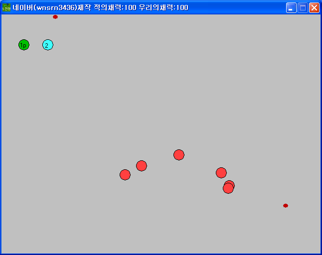

# S War

[한국어](README.ko.md)

A two-player co-op shooter played side by side on one keyboard.

  

## How to play

Download from Releases and run it.

| | Move | Skills |
|---|---|---|
| 1P | Arrow keys | J, L |
| 2P | WASD | T, U |

Bullets fire on their own when you get near an enemy. The skill keys raise a shield or boost movement speed, and the effect wears off after 200 steps. Z and X save and load, and pressing P restarts. There are three stages.

Both players share a single health pool, shown in the window title bar as "우리의채력". Using a skill costs health: 30 for the speed boost and 20 for the shield. When health reaches 0, restart with P.

## How it works

The game keeps health in a single value, GameMaker's built-in `lives`. That is why both players share one health pool and skill costs come out of the same value.

Enemy detection uses an action library from the community. Anything within a set range is always detected, and anything farther away is detected only when it is inside the field of view around the facing direction. This game sets both ranges to 90, so detection depends on distance alone. GameMaker will not open the project unless this library is installed.

## Files

| Path | Contents |
|---|---|
| `source/s-war.gmk` | Original project file |
| `source/lib/AI.lib` | Action library used for enemy detection. Put it in GameMaker's `lib` folder or the project will not open |
| `source/split/` | Text tree produced by GmkSplitter |
| `docs/screenshots/` | Screenshots |
| Releases | Files for distribution |

## Credits

`source/lib/AI.lib` is an action library made by 멍멍이 (qw5628).

## License

CC BY-NC-ND 4.0. Unmodified copies may be shared for noncommercial purposes with attribution. Distributing modified versions and commercial use are not allowed. Bundled libraries, graphics, sounds, and maps made by other people keep their own rights. See [LICENSE](LICENSE).
